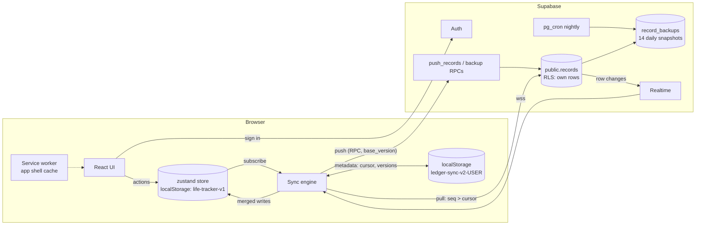

# Architecture

Ledger is a single-page React app (Vite + TypeScript + zustand) that talks to one Supabase project (Postgres + Auth + Realtime).
There is no server code of our own: the only backend is SQL in `supabase/migrations/`.

## Components

| Layer | Where | Role |
|---|---|---|
| UI | `src/pages/**`, `src/components/**`, `src/styles/**`, `src/themes.ts` | Routes: Today, Habits, Tasks, Rejections, Gym, The one, Journal, Books, Entertainment, Character (3D), Rewards, Settings. 13 skins x light/dark. |
| Store | `src/store.ts` | zustand store, persisted to `localStorage` key `life-tracker-v1`. Every item the user owns lives here. Loaded state passes through `src/lib/validate.ts` (invalid items are dropped, never crash the app). |
| Sync engine | `src/sync/engine.ts`, `merge.ts`, `meta.ts`, `runtime.ts` | Runs in the browser (and in Node for the unit tests). Pushes local changes, pulls remote ones, merges. Independent of Supabase: it talks to the `Remote` interface in `src/sync/types.ts`. |
| Remote adapter | `src/sync/remote.ts` | The Supabase implementation of `Remote`: table reads for pull, RPCs for push and backups, a realtime channel for live changes. |
| Facade | `src/sync.ts`, `src/sync/api.ts` | Wires the real store, the Supabase client and browser events (visibility, online/offline, pagehide). The Settings "Data & sync" UI (`src/components/sync/**`) uses `api.ts`. |
| Database | `supabase/migrations/*.sql` | `public.records`, `record_backups`, `push_records()`, backup/restore functions, RLS, triggers, constraints. See `supabase/README.md`. |
| Hosting | Vercel (`vercel.json`) | Static files + security headers. The service worker (vite-plugin-pwa / workbox) makes the app installable and available offline. |

## The server-authoritative sync model

The database is the source of truth. The browser keeps a **disposable cache**: the persisted store plus the sync metadata. Wiping both loses nothing that reached the server.
The contract is `src/sync/types.ts`; the details of one cycle are in `src/sync/README.md`.

> Verification status: everything below is checked against the code and against the SQL run on PGlite (an in-process Postgres) and a mock Supabase HTTP server in tests. It has **not** been run against a real Supabase project (real Auth, PostgREST, Realtime, pg_cron).

- **Items.** Every synced thing is one row `(user_id, collection, id)` with a JSON `data` object, a `deleted` flag (tombstone), a per-item `version` and a global `seq`.
  Collections: habits, habitLogs, tasks, blocks, workouts, body, journal, rewards, xp, books, conversations, rejections, videos, channels, oneLogs, kv, wake, meta (settings). The same allow-list is enforced by a CHECK constraint.
- **Server-owned fields.** `version`, `seq` and `updated_at` are set by a BEFORE trigger. A client cannot choose them, not even from the SQL editor.
- **One write path.** Clients have only `SELECT` on `records`. Writes go through `push_records(items, device_id)`, a SECURITY DEFINER function that checks `auth.uid()`, validates every item (collection, id length, object, at most 600,000 bytes of jsonb text per item, 500 items per call; `LIMITS.maxItemBytes` = 512 KiB in `src/sync/types.ts` is defined but not used by any code) and applies **optimistic concurrency**: the write is accepted only when `base_version` equals the server's version.
  Per-item outcome: `ok`, `conflict` (server row returned), `gone` (tombstone purged), `rejected` (invalid; never retried). Only validation errors become `rejected`; any other database error fails the whole call and the client retries with backoff. A purged tombstone's last version is remembered (`record_tombstone_floor`), so re-creating that id continues from it and a stale device gets `conflict` instead of overwriting.
- **Pull.** `select ... where seq > cursor order by seq`. `seq` is assigned under a per-user advisory lock so a pull never skips a late-committing row.
- **Conflicts.** On `conflict` the engine does a three-way merge per top-level field (base = what this device last saw): only-local change keeps local, only-remote keeps remote, both changed differently keeps the **server** value and records a `server-won` entry holding the local value, which the user can restore from Settings (the conflict list is kept only on that device, newest 100). A remote deletion beats a concurrent local edit (the local copy is kept in the conflict list); a local delete loses to a remote edit made after what this device last saw. `settledThrough` takes the later date. Items never confirmed by the server (seed/cache copies) lose silently to the server copy on first sync.
- **Realtime.** Changes from other devices arrive over a websocket and go through the same apply path as a pull. Polling is the safety net (realtime has no replay): every 20 s while the socket is down, every 60 s while it is live; when realtime (re)connects the engine pulls immediately. Local edits are pushed 600 ms after the last change (debounced). A failed cycle backs off from 1 s up to 5 min with jitter; with changes still pending the retry is 5 s.
- **Cross-tab.** `navigator.locks` ensures one sync cycle at a time across tabs of one browser.
- **Cache-loss guard.** If the local store suddenly looks empty (no non-settings items and 5+ pending deletions, or 20+ deletions that are 60%+ of known items), the engine rebuilds from the server instead of pushing mass deletes.
- **Pending is derived**, not queued: pending = local JSON differs from the last confirmed base. A crash, reload or closed tab therefore cannot lose a queued change.

## What lives where

| Data | Location | Synced |
|---|---|---|
| Habits, logs, tasks, blocks, workouts, body, journal, rewards, XP, books, conversations, rejections, videos, channels, one-exercise logs, wake logs | store collections | yes |
| Settings (theme, skin, targets...) and `settledThrough` | store `settings`, synced as item `meta/settings` | yes |
| User preferences that used to be loose localStorage keys (kv ids: `ledger-cardio`, `ledger-gym-plan`, `ledger-gym-start`, `ledger-gym-skills`, `ledger-habit-view`, `lt-journal-serif`, `ledger-feed-hidden`, `ledger-ht-topics`, `ledger-feed-tab`, `ledger-avatar-seen`, and `ledger-mobility-<date>`; list in `src/lib/synced.ts`) | store `kv` collection | yes |
| Feed result cache (3 h TTL), Invidious mirror list, last good mirror, channel-id lookups | `localStorage` (`ledger-channels-v2`, `ledger-mirror-list`, `ledger-mirror`, `ledger-mirror-ids`) | no, rebuilt on demand |
| A parked copy of an unreadable store blob (only after corruption) | `localStorage` `life-tracker-v1-corrupt` | no |
| Sync metadata (cursor, per-item version/base, quarantine, last conflicts) | `localStorage` `ledger-sync-v2-<userId>` | no, disposable |
| Device id | `localStorage` `ledger-device-id` | no (sent with writes for diagnostics) |
| Supabase session | `localStorage` `sb-*-auth-token` | no |
| 3D models | `public/avatar/*.glb`, cached on first use | no |
| Daily snapshots (retention: dates older than today minus 14 are deleted by the nightly job, so up to 15 dates exist) | `public.record_backups` | server only |

Without `VITE_SUPABASE_URL` / `VITE_SUPABASE_PUBLISHABLE_KEY` the app runs purely local (no sign-in, no sync). `?demo=1` loads sample data in that mode; it is what the E2E tests use.

## Offline behaviour

- The service worker precaches the app shell (JS, CSS, icons) and serves `index.html` for navigations. 3D models are cached on first use, `hackertube.json` is stale-while-revalidate.
- On start, if Supabase does not answer within 2 s the app opens with the saved login so local data still shows.
- Edits are always applied to the store first, so the app never waits for the network. They are marked pending and pushed when the connection returns (`online` event, visibility change, backoff timer).
- Signing out with pending changes asks for confirmation; the sync banner shows the pending count.
- `public/courses.json` is a build-time snapshot of every catalog course playlist (ids, titles, durations; thumbnails come from the video id), cached NetworkFirst. Courses list from it instantly and `src/lib/yt.ts` refreshes from the Invidious mirror in the background, so a dead mirror no longer breaks the Courses tab. Order: fresh localStorage cache, snapshot, live mirror.
- Feed and YouTube content need the network and degrade to an empty state.

## Build and delivery

`vite build` outputs `dist/`; Vercel serves it from the GitHub `main` branch. `vercel.json` rewrites unknown paths to `index.html` (SPA routing) and adds security headers (see `SECURITY.md`). CI is in `.github/workflows/` (see `docs/TESTING.md`).
